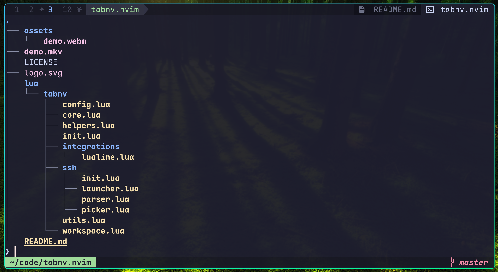

# tabnv.nvim

<div align="center">
  
</div>

## What

A pure, Neovim-only approach to terminal and buffer multiplexing.

## Why

I wrote this plugin because there are currently no tools that meet all of the following criteria:

- Leverage Vim editing, navigation and programmability everywhere (even in terminals)
- Organise terminals (and regular buffers) into workspaces and tabs
  - e.g. I want each project I'm working on to have its own workspace containing multiple tabs
  - each tab of course is an arbitrary arrangement of windows
- Complete and equal support for Linux, macOS and Windows

## Features

- Workspaces (aka sessions), which are a collection of tabs
- A tab containing a terminal is just a Neovim buffer
- Track terminal directories, running commands, and agent activity
- Connect to SSH hosts from a picker, with optional reconnect and password caching
- Works equally well on Linux, macOS, and Windows thanks to Neovide

<div align="center">
  
</div>

- **Workspaces** (top-left):
  - four workspaces are in use here: 1, 2, 3 and 10
  - #3 is the active one
    - it's named *tabnv.nvim* which is the name of the CWD
    - this is the default and can be modified
  - note the ✦ indicator in #2
    - this means there is an agent that is actively working in a tab there
  - note the ◉ indicator in #10
    - this means there is a running process in a tab there
- **Tabs** (top-right):
  - there are two tabs open in the current workspace
  - the first tab contains README.md as active buffer
  - the second tab contains a terminal and is the active tab
- **CWD** (bottom-left):
  - the CWD (current working directory) is tracked as you change directory in your terminal
  - this way you don't need to include the CWD in your shell prompt
- **Git branch** (bottom-right):
  - this is kept in sync as you change your branch

### Out of scope

- Session persistence, as provided by tmux or GNU Screen
- Matching the rendering speed of GPU-accelerated terminal emulators
- Image support (until Neovim itself supports it)

## Prerequisites

- Neovim 0.12 or later is recommended
- [Neovide](https://neovide.dev/) is highly recommended as the UI/front-end because
  - it works equally well on Linux, macOS and Windows
  - imo has the best font rendering and functional animations
  - there's no need for a terminal app since we're using Neovim's terminal emulator
- Statusline and (especially) tabline plugins are highly recommended (e.g. [lualine](https://github.com/nvim-lualine/lualine.nvim))
- [telescope.nvim](https://github.com/nvim-telescope/telescope.nvim) is optional and required only for the SSH picker

## Installation

### vim.pack

```lua
vim.pack.add({ 'https://github.com/thiru/tabnv.nvim' })
require('tabnv').setup()
```

### lazy.nvim

```lua
{
  'thiru/tabnv.nvim',
  ---@type tabnv.Config
  opts = {},
}
```

## Usage

Start Neovim normally, then use:

- `<C-CR>` to open a terminal in a new tab.
- `<C-t>` to open a regular buffer in a new tab.
- `<C-1>`…`<C-0>` to go to workspace 1-10

To start Neovim with an immediate terminal, run:

```sh
nvim +TabnvStart
```

To run a command automatically when the terminal starts:

```sh
nvim +TabnvStart --cmd 'lua vim.g.tabnv_auto_start_cmd = "htop"'
```

The default keymap leader is `<leader><leader>` (your configured leader key pressed twice). Set `leader` in the configuration to change it.

### Default keymaps

#### Terminal mode

| Keymap | Action |
| --- | --- |
| `<C-Space>` | Leave terminal mode |
| `<C-v>` | Paste from the system clipboard |
| `<C-S-v>` | Paste from the default register |
| `<C-j>` | Down |
| `<C-k>` | Up |

#### Tabs

| Keymap | Action |
| --- | --- |
| `<C-t>` | Open a regular buffer in a new tab |
| `<C-CR>`, `<leader>t` | Open a terminal in a new tab |
| `<leader>v` | Open a terminal in a vertical split |
| `<leader>h` | Open a terminal in a horizontal split |
| `<leader>f` | Open a centered floating terminal |
| `<leader>r` | Rename the current tab |
| `<leader>p` | Set a window-title prefix |
| `<leader>s` | Open the SSH picker |
| `<leader>q` | Close the current tab, or quit if it is the last |
| `<leader>Q` | Close the current tab without saving, or quit if it is the last |

#### Workspaces and navigation

| Keymap | Action |
| --- | --- |
| `<C-h>` / `<C-l>` | Previous / next tab in the current workspace |
| `<leader>1`…`<leader>0` | Go to tab 1–10 in the current workspace |
| `<C-,>` / `<C-.>` | Previous / next workspace |
| ``<C-`>`` | Return to the last active workspace |
| `<C-1>`…`<C-0>` | Go to workspace 1–10 |
| `<leader>R` | Rename the current workspace |
| `<C-S-h>` / `<C-S-l>` | Move the current tab left / right |
| `<C-!>`…`<C-)>` | Move the current tab to workspace 1–10 |

## Configuration

Pass options to `setup()` or your plugin manager. See [`lua/tabnv/config.lua`](lua/tabnv/config.lua) for the defaults.

```lua
{
  -- Optional opacity for terminal and non-terminal tabs in Neovide
  neovide_term_opacity = nil,
  neovide_non_term_opacity = nil,

  -- Prefix used by most default keymaps (also see the keymap tables above)
  leader = '<leader><leader>',

  -- Disable the plugin's default keymaps
  default_keymaps_enabled = true,

  -- Callback invoked when the active tab changes
  on_tab_changed = nil,

  -- Maximum length of a running command used as a tab name
  tab_name_as_command_max_length = 30,

  ssh = {
    auto_reconnect = true,
    auto_rename_tab = true,
    password_detection = {
      enabled = true,
      patterns = {
        'password:$',
        '^Enter passphrase for key.*:$',
      },
    },
  },
}
```

## Workspaces

Workspaces group related tabs, similar to sessions in tmux or Kitty. Each workspace has its own tabs, and `<C-h>` / `<C-l>` navigation stays within the active workspace.

- Workspaces are created when you switch to an unused index with `<C-1>`…`<C-0>`
- Empty workspaces are removed automatically
- Names default to the current working directory's name and update when it changes. Rename a workspace with `<leader>R`; custom names remain unchanged when the directory changes

### Tabline integration

Use these functions to add workspace and tab labels to a statusline or tabline:

- `require('tabnv.workspace').tabline_workspaces()` returns formatted workspace labels.
- `require('tabnv.workspace').tabline_tabs()` returns formatted tabs for the active workspace. The active tab uses `TabLineSel` highlighting.

With shell integration, terminal tabs show a process icon while a command is running (OSC 133). Apps that report progress with OSC 9;4 show an agent icon. The same activity indicators appear on workspace labels, and a single-tab label is shown while activity is present.

[Here's an example using Lualine](https://github.com/thiru/dotfiles/blob/master/.config/nvim/plugin/lualine.lua).

## Terminal integration

- **Window title:** combines the optional prefix (`<leader>p`), active workspace name, and current tab name.
- **Directory tracking:** OSC 7 updates the terminal tab's name and tab-local working directory (`tcd`). Modern shells can emit OSC 7 through integrations such as [ohmyzsh's osc7 plugin](https://github.com/ohmyzsh/ohmyzsh/tree/master/plugins/osc7).
- **Command status:** shell integration that emits OSC 133 enables a running-command icon and
  completion notifications.
- **Agent progress:** apps that emit OSC 9;4 progress sequences show an activity icon and trigger a
  notification when activity ends.
- **Desktop notifications:** enabled by default when Neovim loses focus.
- **Tab state:** terminal mode and cursor position are preserved when switching between windows in a tab.

## SSH picker

The picker reads `~/.ssh/config` and `~/.ssh/known_hosts`. Open it with `<leader>s` or `:TabnvSshPicker`. Telescope is required.

- `<CR>` opens the connection in the current buffer.
- `<C-t>` opens it in a new tab.
- `<C-s>` opens it in a horizontal split.
- `<C-v>` opens it in a vertical split.

### Reconnect and password handling

SSH reconnect and password detection are enabled by default and can be configured under `ssh`.

- With `ssh.auto_reconnect`, the SSH session runs in a loop and prompts you to press Enter to reconnect after it ends.
- With `ssh.password_detection.enabled`, tabnv detects SSH password prompts and caches the entered password for reuse. The default Lua patterns are configurable.
- `:TabnvSshPwdReinject {bufnr}` re-arms detection for an SSH terminal buffer (find its number with `:ls`). This resets the scanned-output limit so the next password prompt can be detected again. The reconnect loop does this automatically before reconnecting through `nvim --server` RPC.

Password detection only tracks SSH terminal buffers when enabled.
